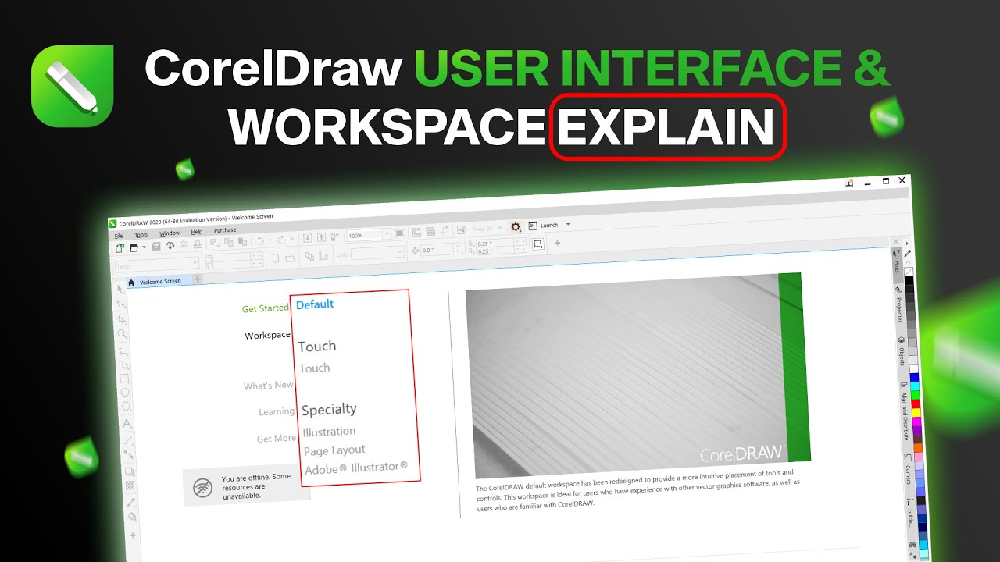
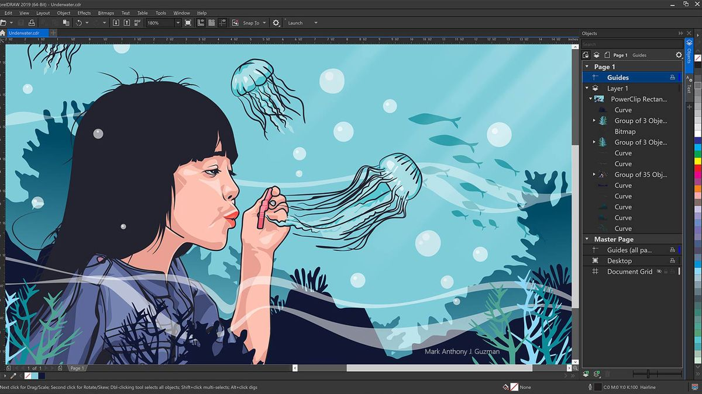

# CorelDRAW for Vector Illustration and Page Layout

CorelDRAW is a graphics application for drawing, typography, and arranging visual content.
It is part of CorelDRAW Graphics Suite and supports work intended for both print and screen.

This independent Corel Graphics guide focuses on decisions that shape an editable design.
People searching for Corel Draw can use it to plan artwork, review exports, and document revisions.

[](https://corel-graphics.github.io/Corel-Draw/)

The supplied source snapshot belongs to Graphite, a separate open-source graphics editor.
Linked Graphite files serve as comparative references for graphics software and example artwork.
They are not CorelDRAW source code, Corel plug-ins, or a CorelDRAW installer.

## Resources

A CorelDRAW Graphics Suite project benefits from a clear output specification.
Record the destination, physical dimensions, required formats, and editing requirements before production.

| Design task | Useful working approach | Delivery check |
| --- | --- | --- |
| Logo construction | Build shapes with deliberate proportions and clean curves | Inspect small sizes and single-color use |
| Vector illustration | Organize related objects and refine important contours | Check overlaps, joins, and unwanted fragments |
| Page layout | Establish margins, alignment, and a readable type hierarchy | Review spacing, text flow, and page boundaries |
| Printed graphics | Confirm dimensions and the printer's color requirements | Check bleed, fonts, and the agreed export settings |
| Web assets | Prepare a composition for the intended display size | Inspect transparency, bounds, and text rendering |
| Reusable artwork | Preserve an editable master and separate delivery copies | Verify that future revisions remain practical |

Use this table to decide what needs inspection at each stage.
A print supplier's specification should take precedence over a generic export recipe.

For vector illustration, start with the largest forms and work toward smaller details.
Avoid adding nodes merely to hide a curve that would be clearer with fewer control points.

- Keep related artwork organized.
- Name important objects so that revisions are easier to discuss.
- Preserve an editable copy before converting text or simplifying objects.
- Compare the composition at its intended viewing size.

For page layout, judge the relationship between content and empty space.
Consistent alignment can make a document easier to scan without adding decoration.

The Graphite snapshot contains [Cargo.toml](Cargo.toml), which describes its Rust workspace.
It helps identify the supplied project and does not provide a way to build CorelDRAW.

## Screenshots

Useful screenshots should show an editing decision and its result.
Choose views that explain the document rather than merely displaying an application window.



For a logo review, show the artwork at normal size and at a small reproduction size.
For a multipage document, include enough context to assess alignment and repeated elements.

The supplied Graphite documents can be used as separate visual study material:

- [valley-of-spires.graphite](demo-artwork/valley-of-spires.graphite)
- [red-dress.graphite](demo-artwork/red-dress.graphite)
- [procedural-string-lights.graphite](demo-artwork/procedural-string-lights.graphite)
- [isometric-fountain.graphite](demo-artwork/isometric-fountain.graphite)

These documents use Graphite's own format.
Do not describe them as CorelDRAW templates or assume that CorelDRAW can open them directly.

When presenting your own design, explain the purpose of the selected view.
A close-up is useful for curve quality; a full-page view is useful for balance and hierarchy.

- Use readable zoom levels.
- Keep selection handles visible when they explain the operation.
- Show the final export separately from the editable document.
- Remove private client information before sharing a screenshot.

## Integrations

File exchange is part of a design workflow, so review the receiving application as well as the source.
Check which features survive the chosen format and which may be flattened or converted.

CorelDRAW supports SVG export, as described in its [export documentation](https://product.corel.com/help/CorelDRAW/Documentation-Windows/CorelDRAW-en/CorelDRAW-Export-assets.html).
Keep the original editable document when preparing an exchange file.

The following Python example inspects the root attributes of an existing SVG export.
It uses Python's standard XML library and does not call a CorelDRAW API.

```python
import xml.etree.ElementTree as ET
root = ET.parse("artwork.svg").getroot()
print("Root element:", root.tag)
for name in ("width", "height", "viewBox"):
    print(f"{name}: {root.get(name, '(not set)')}")
```

Run this kind of check only on an SVG file you intend to inspect.
It reports declared dimensions and coordinates; it does not validate rendering or print readiness.

The [ElementTree documentation](https://docs.python.org/3/library/xml.etree.elementtree.html) describes the parsing interface.
Visually compare the exported image in the destination application after checking its metadata.

The supplied Graphite code illustrates communication between editor and desktop components:

- [message_dispatcher.rs](desktop/wrapper/src/message_dispatcher.rs) handles message dispatch.
- [messages.rs](desktop/wrapper/src/messages.rs) defines desktop-related message types.

Those interfaces belong to Graphite.
They should not be used as CorelDRAW automation instructions.



## Community

A useful design question includes the goal, the relevant settings, and the observed result.
For a file exchange issue, identify both the exporting and receiving applications.

Include these details when requesting help:

- CorelDRAW edition and version.
- Operating system and display scaling when relevant.
- Document dimensions and measurement units.
- Export format and the settings that affect the problem.
- A small example that reproduces the difference.

Describe the visual symptom precisely.
For example, distinguish a changed line weight from a changed object size.

The Graphite source offers related references for interface behavior:

- [window.rs](desktop/src/window.rs) contains desktop window code.
- [view.rs](desktop/ui/src/view.rs) tracks view information.
- [keymap.rs](desktop/ui/src/input/keymap.rs) maps keyboard representations.
- [resources.rs](desktop/ui/src/resources.rs) handles interface resources.
- [win.rs](desktop/ui/src/platform/win.rs) contains Windows-specific process support.

These files can inform a technical discussion about another editor's implementation.
They do not establish how CorelDRAW implements its own interface.

## Contributing

Documentation contributions should make a task easier to reproduce.
State which application a command or example belongs to and describe any prerequisites.

For a delivery handoff, record a file hash after approving the export.
This PowerShell example reads an existing PDF and displays its SHA-256 digest.

```powershell
$exportPath = "approved-artwork.pdf"
$digest = Get-FileHash -LiteralPath $exportPath -Algorithm SHA256
$digest | Format-List Algorithm, Hash, Path
```

The command uses PowerShell's [Get-FileHash](https://learn.microsoft.com/en-us/powershell/module/microsoft.powershell.utility/get-filehash) cmdlet.
A hash helps compare file contents across a handoff; it does not prove that the artwork is correct.

Before suggesting a documentation change:

- Confirm the terminology against the relevant application version.
- Separate tested behavior from illustrative examples.
- Check that source links point to the intended project.
- Explain whether a proposed workflow preserves editability.

Graphite's supplied developer tools include two distinct entry points:

- [main.rs](tools/editor-message-tree/src/main.rs) generates an editor message tree.
- [main.rs](tools/crate-hierarchy-viz/src/main.rs) supports workspace dependency visualization.

Its browser automation examples also include:

- [new-document.jsonl](tools/web-editor-driver/scenarios/new-document.jsonl) describes a new-document scenario.
- [draw-rectangle.jsonl](tools/web-editor-driver/scenarios/draw-rectangle.jsonl) describes a rectangle-drawing scenario.

These tools and scenarios target Graphite.
Their coordinates, key bindings, and message conventions are not a CorelDRAW test interface.

## Further reading and more information

Use the [official CorelDRAW product page](https://www.coreldraw.com/en/product/coreldraw/) to check product scope.
Consult the [CorelDRAW community](https://community.coreldraw.com/) for application-specific discussions.

Choose learning material that matches your edition, version, and intended output.
A short exercise with known dimensions makes export differences easier to diagnose.

Keep the source document, the approved export, and the delivery specification together.
This gives future revisions a clear reference for both appearance and technical requirements.

## Related Search Terms

Corel Graphics, Corel Draw, CorelDRAW Graphics Suite, vector illustration, page layout, vector-graphics, graphic-design, graphics-editor, design, graphics, svg, svg-editor, illustration, typography, page-layout
